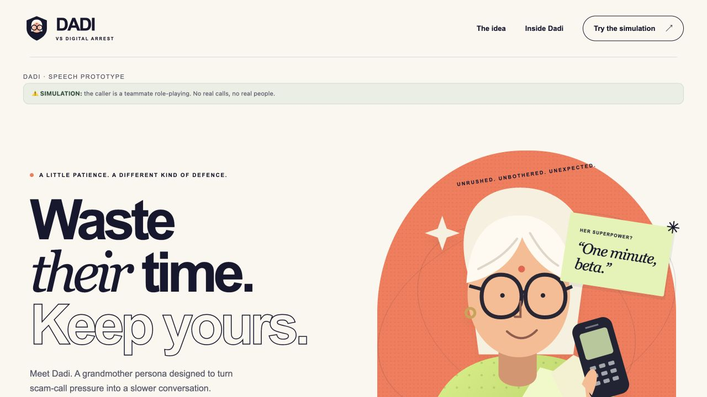

# Dadi vs Digital Arrest

Repository: [BharathM-20/Ajji-Dadi](https://github.com/BharathM-20/Ajji-Dadi) (private).

**They bring urgency. Dadi brings a missing pair of glasses.**

A hackathon scam-awareness prototype inspired by O2's Daisy. A fictional grandmother keeps a
teammate role-playing a scammer engaged through patient questions, contextual replies and
assigned stalling tactics. A human decides whether Dadi should handle the conversation.

**SIMULATION ONLY:** no real telephone connection, real scammers, payments or sensitive data.
Real scam prevention, money saved and multi-minute engagement have not been demonstrated.



## What is implemented

- Interactive product showcase, scripted story explorer and responsive call workspace.
- Microphone → validated short WAV → Gnani Prisma STT → configured brain → Gnani Timbre TTS.
- Sarvam brain adapter with versioned prompt, bounded context, tactic tracking and output guards.
- Hindi, Hinglish, Kannada, Kanglish and English speech routing.
- Human decision gate, report, reset, per-stage timing and transactional speech-error recovery.
- Clearly labelled key-free test transport, offline tests and user-run smoke/evaluation scripts.

The code is verified with mocked HTTP. **Real Sarvam authentication/latency/quality, Kannada
and Kanglish quality, physical audio and Kalpana's Kannada pronunciation remain unverified.**
Canned fixtures demonstrate the integration, not a model's ability or language quality.

## Quick start — macOS/Linux

Use **Python 3.13.7**, as pinned in [.python-version](.python-version). Run commands from the
repository root. No Node, GPU, Ollama or API keys are needed for the fixture demo.

For a fresh machine with internet access, install the Python dependencies explicitly:

```sh
python3.13 -m venv .venv
.venv/bin/python -m pip install -r requirements.txt
make setup
```

`make setup` itself is deliberately **offline**. It validates the exact Python version,
installs/checks dependencies from the local pip cache or a wheelhouse, and never downloads:

```sh
# If packages are already available locally:
make setup
# Or supply local wheels:
WHEELHOUSE=/absolute/path/to/wheels make setup
```

Direct dependencies are pinned in [requirements.txt](requirements.txt); there is no complete
transitive dependency lock yet. Use a full Git clone: some historical regression tests inspect
baseline commits and cannot run from a source ZIP without Git history.

## Run the key-free showcase and speech UI

```sh
DADI_MODE=sarvam DADI_SPEECH=1 DADI_SARVAM_MOCK=1 SARVAM_FALLBACK_LOCAL=0 GNANI_REAL_ASR=0 GNANI_REAL_TTS=0 .venv/bin/python -m src.app
```

Open the **URL printed by that process**. If another instance already uses port7860, Gradio
may choose another port. Restart an older running process before expecting it to load new code;
a browser refresh alone does not reload Python modules.

Explore the scripted story, then choose **Try the simulation**. In the call lab:

1. Choose a language before the first recording. The choice locks for that call.
2. Record/stop twice for screening. Browser microphone permission is required.
3. Choose **Let Dadi handle it**; Pick up and Decline remain human alternatives.
4. Record/stop another turn, then use **End call + report** or **New call**.

In this fixture mode, ASR returns fixed mock text, Sarvam replies are canned, and TTS returns
no audio. The visible **TEST FIXTURE** label is intentional. The story explorer is also scripted
and never invokes a provider. This mode is not a real transcription or voice-quality demo.

For the unchanged original MOCK UI, use `.venv/bin/python -m src.app` with `DADI_MODE` and
`DADI_SPEECH` unset. Local Ollama remains an explicit optional backend, documented separately
in [LOCAL_BRAIN.md](docs/LOCAL_BRAIN.md); it is not needed for the Sarvam path.

## Real speech — user-run only

Set `SARVAM_API_KEY` and `GNANI_API_KEY` privately in the **process environment**. Do not paste
keys into source, chat, screenshots or issues. The app does not load `.env` or other key files.
Then explicitly enable real services:

```sh
unset GNANI_TTS_LANGUAGE GNANI_STT_KANGLISH_CODE
DADI_INCOMING=0 DADI_MODE=sarvam DADI_SPEECH=1 \
DADI_SARVAM_MOCK=0 SARVAM_FALLBACK_LOCAL=0 \
SARVAM_MODEL=sarvam-105b-conversations \
SARVAM_REASONING_EFFORT=none SARVAM_MAX_TOKENS=150 \
GNANI_REAL_ASR=1 GNANI_REAL_TTS=1 \
.venv/bin/python -m src.app
```

This mode makes paid/provider calls. Follow [SPEECH_UI.md](docs/SPEECH_UI.md) for full launch,
click-path and evidence instructions. Provider contracts/configuration are in
[SARVAM_NOTES.md](docs/SARVAM_NOTES.md) and [GNANI_NOTES.md](docs/GNANI_NOTES.md).

- Set `SARVAM_REASONING_EFFORT=none`: the user-tested setting sends explicit JSON null.
  Unset omits the field; other values fail configuration.
- Leave `GNANI_TTS_LANGUAGE` unset to follow the UI; an explicitly set value overrides TTS only.
- Hindi/Hinglish use `hi-IN` and Devanagari replies; Kannada/Kanglish use `kn-IN` and Kannada
  replies; English uses `en-IN`. These are routes, not verified quality claims.
- The optional Kanglish `kn-IN,en-IN` candidate is **UNVERIFIED**; default is `kn-IN`.
- Recordings must be complete PCM WAV and at most30seconds. This UI does not require ffprobe.
- The existing pause after a speech turn over10seconds is retained.
- Sarvam HTTP/response failures can use local fallback **only** when explicitly enabled.
  Missing-key/configuration errors fail before fallback. Fallback is labelled, never silent.

## Verification

```sh
make check
make smoke
```

`make check` runs lint and offline tests, including real loopback-only Gradio launches with
mocked providers. Tests do not contact speech/model services. Launch tests need permission
to bind localhost; a restrictive sandbox can block them. GitHub Actions configuration runs
the same commands without provider secrets. The [initial hosted CI run](https://github.com/BharathM-20/Ajji-Dadi/actions/runs/41282820261) passed.

Default fixture evaluation (no real provider calls):

```sh
.venv/bin/python scripts/eval_brain.py
```

The saved fixture run reports **29 PASS / 1 name-recall FAIL** and exits1: canned text does not
prove memory recall. This is an honest failed eval criterion, not a passing model benchmark.
See [PROMPTS.md](docs/PROMPTS.md) and [the raw fixture output](docs/evidence/sarvam_fixture_eval.txt).

Only the user should run these real-service commands after reviewing their cost/access:

```sh
.venv/bin/python scripts/smoke_sarvam.py
.venv/bin/python scripts/smoke_real.py --audio clips/hinglish.wav
.venv/bin/python scripts/eval_brain.py --real
```

## Architecture and project map

Gradio `app` → speech/session orchestration → provider `adapters`.
All external provider HTTP stays in `src/adapters.py`. Gnani calls are serialized; ASR, brain
and TTS execute sequentially. Failed speech turns preserve conversation state. Human choices
and simulation labels remain permanent. Output guards are heuristics, not a semantic-safety proof.

- `src/`: app, presentation, speech/session logic, prompt/guards and provider adapters.
- `scripts/`: setup, verification, user-run smoke/eval and isolated research tools.
- `tests/`: mocked regression suites, fixtures and loopback launch probes.
- `docs/`: decisions, contracts, architecture, progress, test logs and labelled evidence.
- `reference/`: preserved original inputs; not the current app entry point.
- `training/`: synthetic research data and a rejected experimental pilot; not the deployed brain.
- `clips/`, `fillers/`: local audio locations; recordings/generated audio are not committed.

Start with [SPEECH_UI](docs/SPEECH_UI.md), [ARCHITECTURE](docs/ARCHITECTURE.md),
[PROGRESS](docs/PROGRESS.md), [DECISIONS](docs/DECISIONS.md), [TEST_LOG](docs/TEST_LOG.md),
[QUALITY](docs/QUALITY.md) and [the GitHub readiness audit](docs/GITHUB_READINESS.md).
Historical logs retain prior failures and local machine paths; the newest handoff sections
explain the current state. See [CONTRIBUTING.md](CONTRIBUTING.md) before changing frozen contracts.

Maintainer: [BharathM-20](https://github.com/BharathM-20). No project license has been selected
in this checkout; a license decision is pending owner approval.

## Incoming-call replay (opt-in)

A separate website demo can screen prerecorded caller-only WAV clips rather than ask a judge
to record each turn. It also has a clearly labelled key-free **text** fixture, with scam and
legitimate cases in the five supported language choices. It is not telephone interception.
See [INCOMING_CALL_DEMO.md](docs/INCOMING_CALL_DEMO.md) for the launch command, four-clip format,
autoplay/manual controls, classification source and limits. Real multilingual recordings are
not bundled; native review and actual end-to-end service trials are still required.

Speech diagnosis and recovery: [STT_RECOVERY](docs/STT_RECOVERY.md) explains no-call microphone
inspection, original-byte playback/download, one explicit manual retry and bounded STT-only
comparisons. Real504recovery and Kannada recognition quality still require user evidence.

Kannada/Kanglish STT now requests explicit `prisma-v3.0`; other language model defaults are
unchanged. One unchanged-WAV user test succeeded; full real website and broader quality still
need review. Keep **Inspect recording only** unchecked for a real conversation.

### Invited prototype login

See [docs/ACCOUNTS.md](docs/ACCOUNTS.md) for the500-record local mock database and private
account provisioning. Run `.venv/bin/python scripts/manage_users.py --add bharath`, enter a
password at the hidden prompts, then add `DADI_LOGIN=1` to the existing app launch command.
The default launch stays available without login. Login does not enforce API-credit quotas.
After two speech answers, listen to/read the caller briefing and confirm it to reveal the
human decision buttons. The first recording is the reason; the second is name/organisation.


The main speech UI now asks for intent after a greeting, which does not count as an answer.
A short Sarvam-generated briefing states only caller name and intent, with unknown fields
explicit. It no longer reads back full caller answers. Prompt sarvam-dadi-v10 prioritizes the
latest request and gentle situational humour over a stock delay. Restart the app and choose
New call to test the changes. These prompt changes have offline evidence; live naturalness
and humour still require user review. See docs/SPEECH_UI.md and docs/SARVAM_NOTES.md.

Sarvam now defaults to `sarvam-105b-conversations`. Before the existing real launch command,
run `export SARVAM_MODEL=sarvam-105b-conversations` in the terminal holding your keys to
replace a stale model override. Restart the site and choose New call. The context-first v10
prompt stays active. Model availability, live naturalness and JSON-summary quality still need
your test. To compare the previously tested model, use `SARVAM_MODEL=sarvam-105b` instead.
### AJJI cloned voice (local opt-in)

The private clone response belongs at `data/ajji_embedding.json` (already ignored by Git).
Start the existing speech app with `GNANI_REAL_TTS=1 GNANI_TTS_PROVIDER=ajji` and a
`GNANI_API_KEY` exported in that same terminal. AJJI uses `vachana-vc-v1` and returns
44.1 kHz mono WAV files to the existing Gradio player. Keep `GNANI_TTS_PROVIDER=timbre`
for the earlier Kalpana voice. The normal TTS model, voice, language and speed settings
do not apply to the clone request. This does not change speech recognition or the brain.
Marathi is available for a separate TTS probe, but the call UI does not yet offer Marathi.
Cross-language pronunciation and voice likeness require user listening.
AJJI WAV playback is stretched locally to about 90% pace after synthesis; the reply
text and Gnani request remain unchanged. Listen for any artifacts before a public demo.
